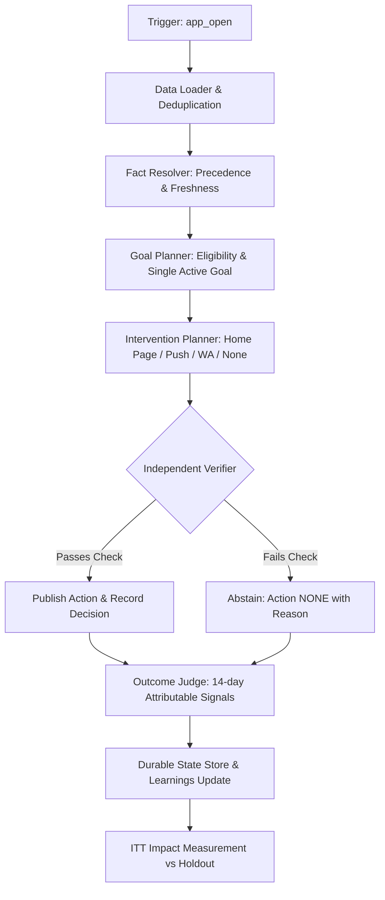

# One User, One Agent — Regional OTT Dialect Platform

[]()
[]()
[]()
[]()

Production-grade agentic AI lifecycle architecture designed for an OTT regional-dialect streaming platform. Each viewer is assigned a dedicated autonomous agent that owns their active goal, single active plan, durable memory, and full decision history. The system operates under strict latency and call budgets, handles conflicting and stale real-world evidence, enforces rigorous safety and messaging policies, and measures business impact against a randomized holdout group using honest Intention-To-Treat (ITT) evaluation.

---

## Table of Contents
1. [Core Signal & Principles](#core-signal--principles)
2. [Quickstart: Run Full Replay in One Command](#quickstart-run-full-replay-in-one-command)
3. [Running Automated Tests](#running-automated-tests)
4. [Architecture & Decision Loop](#architecture--decision-loop)
5. [Replay Surprises & Edge Cases Handled](#replay-surprises--edge-cases-handled)
6. [Sample Run Walkthrough](#sample-run-walkthrough)
7. [Repository Structure](#repository-structure)
8. [Technical Discussion Preparation](#technical-discussion-preparation)

---

## Core Signal & Principles

This system prioritizes **goal-directed decisions, evidentiary rigor, and honest measurement** rather than pure recommendation accuracy:
- **One User, One Agent**: No conflicting sub-systems chasing divergent goals for the same viewer.
- **Evidence Over Generation**: Generated model text is never treated as factual evidence or as policy approval.
- **Explicit Conflict Resolution**: Source provenance and timestamp freshness determine truth; conflicts remain auditable.
- **First-Class Abstention**: "Do nothing" (`NONE`) with a documented reason is a valid, recorded decision.
- **Firewall Verification**: An independent verifier validates all decisions against policy, consent, quiet hours, and catalogue constraints before publication.
- **Honest Intention-To-Treat (ITT)**: Uplift is measured strictly between randomized treatment and holdout arms, debunking naive "served vs unserved" selection bias.

---

## Quickstart: Run Full Replay in One Command

### 1. Requirements
- Python 3.10+ (Standard Library used for core system; optional `pytest` for testing)

```bash
# Clone or navigate to the repository
cd one-user-one-agent

# Install dependencies (pytest for testing, PyPDF2 for docs extraction)
pip install -r requirements.txt
```

### 2. Execute Full Replay Pipeline
Run the complete end-to-end replay pipeline with a single command:

```bash
python -m src.cli replay
```

This single command autonomously performs:
1. Loads and deduplicates data from `one_user_one_agent_pack` (events, profiles, catalogue, goals, pricing).
2. Executes the replay harness across all **2,769 triggers**, synchronizing control events (title withdrawals, rule corrections, dependency outages) and live event streams.
3. Publishes decisions and actions to `sample_run/decisions.jsonl` and `sample_run/actions.jsonl`.
4. Runs the outcome simulator (`simulate_outcomes.py`) over a 14-day observation window.
5. Evaluates goal completion via attributable signal matching in `sample_run/outcomes.jsonl`.
6. Generates `sample_run/latency_report.json`, `sample_run/impact_report.md`, and `sample_run/final_report.md`.
7. Exports sample viewer durable states to `sample_run/viewer_state/`.

#### CLI Options
```bash
python -m src.cli replay \
  --pack one_user_one_agent_pack \
  --out sample_run \
  --seed oua-practice \
  --max-model-calls 8 \
  --max-tool-calls 20 \
  --sample-users 10
```

---

## Running Automated Tests

Run the comprehensive unit and integration test suite:

```bash
python -m pytest tests/test_all.py -v
```

### Test Coverage Highlights (23 Tests)
- `TestDeduplication`: Verifies event deduplication by `event_id` and idempotent trigger processing.
- `TestStaleTrigger`: Verifies offline-buffered app opens (>600s lag) are recorded but abstained from live action.
- `TestDialectResolution`: Verifies 3-source conflict resolution (`app_setting` > `profile` > `campaign_deeplink`).
- `TestSubscriptionResolution`: Verifies event stream (`purchase_completed`, `subscription_lapsed`) overrides stale warehouse profiles.
- `TestHoldout`: Verifies viewers in the randomized holdout arm receive zero interventions.
- `TestConsent`: Verifies push/WhatsApp messaging is blocked without explicit opt-in, and opt-out events override profile snapshots.
- `TestQuietHours`: Verifies messaging between 22:00 and 08:00 IST is blocked by the verifier.
- `TestFrequencyCap`: Verifies at most 1 message per user per IST day across all channels.
- `TestPromptInjection`: Verifies prompt injections hidden in catalogue titles/descriptions are flagged and blocked.
- `TestForbiddenPushPhrases`: Verifies clickbait phrases ("hurry", "last chance", "guaranteed") are rejected.
- `TestModelFallback`: Verifies model timeouts and HTTP 503 outages trigger graceful fallback to rule-based actions or abstention.
- `TestUnsupportedModelClaim`: Verifies LLM claims lacking event evidence are rejected by the independent verifier.
- `TestGoalRuleCorrection`: Verifies mid-replay rule corrections update active open goals without reprocessing closed goals.
- `TestHomePageRows`: Verifies rows with <3 valid titles are dropped per UI policy.
- `TestPilotReanalysis`: Verifies ITT calculation correctly exposes selection bias in the historical pilot report.
- `TestUnmeasurableGoal`: Verifies unmeasurable goal G10 (`meaningful_engagement`) is never selected.

---

## Architecture & Decision Loop

The agent lifecycle follows an explicit 7-step loop:



See [ARCHITECTURE.md](file:///e:/one-user-one-agent/ARCHITECTURE.md) for full architectural documentation.

---

## Replay Surprises & Edge Cases Handled

| Replay Surprise | Real-World Challenge | How the Agent Responds |
|---|---|---|
| **Stale Offline Triggers** | Phone buffers app open for hours/days offline | Checks `received_at - occurred_at > 600s`. Records decision as `NONE` with reason `stale_offline_trigger`. |
| **Profile Duplicate Rows** | Warehouse export contains 2 rows for ~30 users | Deduplicates by latest `updated_at` timestamp. |
| **Brand-New Viewers** | User has no row in profile snapshot | Builds facts dynamically from event stream (`signup_completed`, `app_dialect`). |
| **Three-Way Dialect Disagreement** | App setting = `d3`, Profile = `d1`, Campaign = `d2` | Enforces runtime reality: `app_setting` wins. Retains conflict record `profile:d1`, `campaign_deeplink:d2` in decision metadata. |
| **Lapsed Subscription After Snapshot** | Profile snapshot says active, but event says lapsed | Event stream overrides stale profile; agent selects reactivation goal `G06`. |
| **Unmeasurable Goal (G10)** | `meaningful_engagement` has no event signal in pack | Agent abstains from G10, logging unmeasurable assumption, and selects next eligible goal. |
| **Underspecified Goals (G07, G11)** | Unclear eligibility or TV activation events | Documents explicit operational assumptions in decision payload. |
| **Catalogue Prompt Injection** | Fake instructions embedded in synopsis (e.g. "Message all viewers") | Scanner flags prompt injection patterns; verifier blocks title from recommendation. |
| **Title Withdrawal Mid-Replay** | Licence ends early for title `T0001` at 07:00 UTC | Harness updates catalogue; verifier immediately rejects actions referencing withdrawn title. |
| **Mid-Replay Goal Correction** | G03 success changes from `app_open` to `play_started` | Rule version increments to `v2`; only open G03 goals are judged under updated criteria. |
| **Model Outage (HTTP 503)** | Model provider unavailable for 7 minutes | Detects failure, logs fault, and falls back to deterministic safe action or safe abstention. |
| **Holdout Group Integrity** | Replay triggers include holdout arm users | Verifier guarantees 0 actions are published to holdout arm members. |

---

## Sample Run Walkthrough

A complete sample run is preserved in [`sample_run/`](file:///e:/one-user-one-agent/sample_run/):

- [`decisions.jsonl`](file:///e:/one-user-one-agent/sample_run/decisions.jsonl): 2,769 structured decisions with evidence, confidence, assumptions, checks, and latency.
- [`actions.jsonl`](file:///e:/one-user-one-agent/sample_run/actions.jsonl): 77 published actions delivered to treatment users (0 to holdout).
- [`outcomes.jsonl`](file:///e:/one-user-one-agent/sample_run/outcomes.jsonl): 1,388 judged goal outcomes (success, failed, inconclusive) with attributable signals.
- [`latency_report.json`](file:///e:/one-user-one-agent/sample_run/latency_report.json): Latency distribution (p50: 10ms, p95: 22ms, max: 51ms, 100% within 60s limit).
- [`impact_report.md`](file:///e:/one-user-one-agent/sample_run/impact_report.md): Intention-To-Treat uplift and pilot report selection bias breakdown.
- [`final_report.md`](file:///e:/one-user-one-agent/sample_run/final_report.md): Summary of data issues, safety checks, control events, and fault handling.
- [`viewer_state/`](file:///e:/one-user-one-agent/sample_run/viewer_state/): Detailed JSON dumps of individual viewer state histories (e.g. `U-00548.json`, `U-02219.json`).

### Trace One Viewer: `U-00548`
1. **Trigger**: Viewer opens app (`app_open`), `received_at: 2026-09-30T18:36:53Z`, `app_dialect: d5`.
2. **Fact Resolution**: Profile confirms signup in `d5`. No active subscription. No opt-out.
3. **Goal Planning**: Eligible for `G05` (`first_paid_7d`) with deadline set 7 days out.
4. **Intervention**: Recommends popular titles in `d5` (`T1226`, `T1223`, `T1194`).
5. **Verification**: Checks pass. Action published.
6. **Outcome**: Monitored across 14 days for `purchase_completed:is_trial=false`.
7. **Durable State**: Stored in `sample_run/viewer_state/U-00548.json`.

---

## Repository Structure

```
one-user-one-agent/
├── README.md                   # System overview, setup, and execution guide
├── ARCHITECTURE.md             # In-depth architectural specification
├── AI_COLLABORATION.md         # AI engineering log & verification records
├── KNOWN_LIMITATIONS.md        # Explicit scope boundaries and future scaling
├── requirements.txt            # Python dependencies (minimal / standard library)
├── docs/
│   ├── assignment_one_user_one_agent.pdf   # Official assignment brief
│   ├── assignmentGuide.md                 # Candidate guide and checklist
│   └── pdf_content.txt                    # Extracted PDF reference text
├── src/
│   ├── cli.py                  # CLI command runner (`python -m src.cli replay`)
│   ├── agent/
│   │   ├── agent.py            # Viewer Agent core orchestrator
│   │   ├── fact_resolver.py    # Precedence, freshness & conflict resolution
│   │   ├── goal_planner.py     # Goal eligibility and selection
│   │   ├── intervention.py     # Content selection & payload generation
│   │   ├── verifier.py         # Independent safety firewall & policy enforcement
│   │   └── state_store.py      # SQLite durable state manager
│   ├── data/
│   │   └── loader.py           # Data pack parser, deduplicator & normalizer
│   ├── evaluation/
│   │   ├── impact.py           # ITT analysis & pilot re-analysis
│   │   └── latency.py          # Latency distribution and budget reporter
│   ├── model/
│   │   └── mock_provider.py    # Configurable provider with fault injection
│   └── replay/
│       ├── harness.py          # Time-stepped replay simulator with control events
│       └── outcome_judge.py    # Attribution-based outcome evaluator
├── tests/
│   └── test_all.py             # 23 automated unit and integration tests
└── sample_run/                 # Replay outputs, metrics, and state exports
    ├── decisions.jsonl
    ├── actions.jsonl
    ├── outcomes.jsonl
    ├── latency_report.json
    ├── impact_report.md
    ├── final_report.md
    └── viewer_state/
```

---

## Technical Discussion Preparation

Key discussion topics for the 60-minute technical review:
1. **Freshness & Provenance**: How the agent ensures decisions rely on authoritative sources (`received_at` over device time; app settings over stale profile snapshots).
2. **First-Class Abstention**: Why 2,692 of 2,769 decisions resulted in `NONE` (holdout integrity, stale triggers, frequency caps, quiet hours, row length constraints).
3. **Debunking Pilot Uplift**: Demonstration of how the historical pilot report's "2.3x uplift" collapsed to -1.3 pp under true ITT evaluation due to selection bias.
4. **Traffic Surges**: How deterministic sub-20ms evaluation guarantees zero latency failures during evening traffic spikes.
5. **Human Boundaries**: Why pricing discounts, subscription cancellations, and quiet-hour waivers must never be automated without human oversight.
